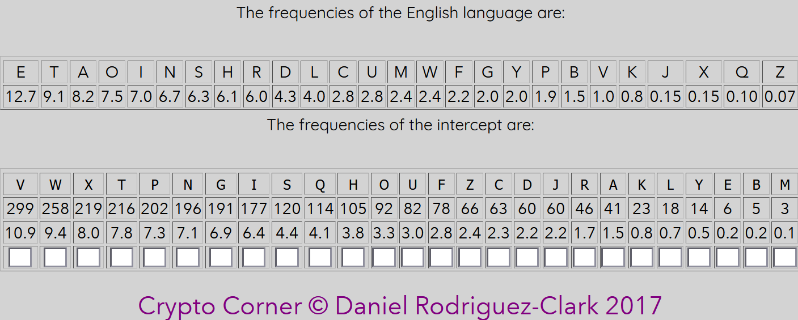

1. Find frequencies on the intercept using https://crypto.interactive-maths.com/frequency-analysis-breaking-the-code.html

which reveals that V is the most common letter, possible replacement is E.

2. Found 'WQe' in the text, possible assumption is that this is the word 'the'
   so we replace W for T and Q with H

3. find - thTt - most probable replacement for T = 'a'
   so that we have 'that'

4. thaG - tha\* - only possibilities are that or than, since we already have t, that means G can only be 'n'

5. aP + thePe - thePe -> either its there or these, since aP cant be ar, then must be that P = 's'

6. Xs Xt Xn nad taXnt - since 'a' and 'e' are taken, the only plausible candidate is 'i' for X.

7. nNne since 'i' is taken - only plausable subsitution for N is 'o'

8. theIe - since 's' is already used, the most plausible subsition is 'r'

9. enerJies - only plausible substition for J is 'g'

10. haO and hanO, most plausible substiution for O is 'd'

11. Airds - only possible subsitiution for A is 'b'

12. iZUortant - only plasuble Z - 'm', U - 'p'

13. peopSe - plausible for S is 'l'

14. aHHording - H for 'c'

15. eYempliCied - Y for 'x'. C for 'f'.

16. storFtelling - F for 'y'

17. sDperficial - D for 'u'

18. serKed - K for 'v'

19. Rhatever and Rith - R for 'w'

20. acBuiring - B for 'q'

21. blacL - L for 'k'

22. Eiu-Eitsu - E for 'j'

23. wiMard = M for 'z'
